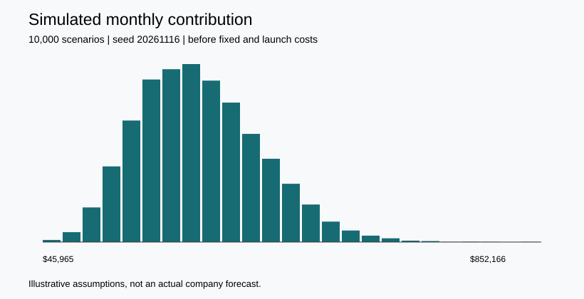

# Optimization and Product Launch Risk

A reproducible educational analysis using linear programming and Monte Carlo simulation. Not a production forecast.



**Verified result:** $42,142.86 optimal daily blending contribution. The seeded simulation demonstrates how fixed costs change launch risk. See [results](RESULTS.md).

Two reproducible decision-support examples: allocate constrained raw materials to maximize contribution, and examine product contribution under uncertain demand, selling price and variable cost.

## Run

Use Python 3.14 with the versions in `requirements.txt`:

```text
python -m pip install -r requirements.txt
python analysis.py
python -m unittest -v
```

The script writes `outputs/results.json`, a synthetic `simulation.csv`, and an SVG histogram. Assertions check optimization feasibility, the reference objective, and deterministic simulation reproduction. It does not connect to external services or refresh any data.

## Gasoline blending

Four inputs have octane levels 86/88/92/96, variable costs $17/$18/$20.50/$23 per barrel, and supply caps 20,000/15,000/15,000/10,000 barrels. Regular and Premium require octane 89 and 93, sell for $19.50 and $22, and have demand caps 35,000 and 23,000 barrels.

Eight nonnegative allocation variables determine material flows. Supply and demand are upper bounds. Octane constraints use linear weighted sums, not division by potentially zero production. SciPy HiGHS solves the linear program. Supply scenarios independently re-solve after adding 2,000 barrels of each input; gains assume existing per-barrel input costs and exclude additional sourcing fees.

Important corrections: low-octane material can be used in a higher-octane product when blended appropriately. A material absent from an optimal allocation is not necessarily physically unusable. Higher selling price is not synonymous with higher profit margin. Binding supply alone does not quantify the benefit of expansion.

## Product contribution simulation

10,000 independently sampled scenarios use demand Normal(10,000,2,000), price Uniform(50,70), and unit variable cost Normal(30,5). Negative demand and cost draws are clipped to zero. Units are continuous as in the mathematical scenario; a real planning model may need integer quantities.

Contribution = demand * (price - variable unit cost). This is **not net profit**: fixed costs, launch costs, tax, financing, capacity, returns and marketing are absent. Fixed monthly cost scenarios are explicitly illustrative additions, not researched estimates.

The seed is fixed at 20261116. Results intentionally need not match an old unseeded report. The confidence interval for the simulated mean describes Monte Carlo precision conditional on the assumptions. The scenario percentile range describes variation under those assumptions. Neither captures uncertainty in whether those assumptions are correct.

An all-positive finite sample is not proof of zero loss probability. Sample minima/maxima are not guaranteed bounds. Independent price and demand do not justify recommending higher prices without testing price elasticity. No arbitrary cash-reserve or launch recommendation is made.

## Evidence and attribution

Reconstructed independently from the author's completed CIS 3252W prescriptive analytics coursework, with newly written code and tests. The coursework identified these background sources:

- Gasoline blending case: https://www.uky.edu/~dsianita/300/online/LP.pdf
- Monte Carlo background: [DataCamp: Monte Carlo Simulation in Excel](https://www.datacamp.com/tutorial/monte-carlo-simulation-in-excel). Background reading only; no article text, code or images reproduced.

No instructor materials, graded report, personal identifiers, or real customer data are included. The scenario quantities are educational case inputs. Source PDFs, classroom instructions, graded reports, and third-party code/images are not redistributed. References credit the scenario background; no license to those external materials is asserted. The linked UKY PDF was unavailable during review. This repository contains independently written analysis code, a short parameter specification and newly generated results, not a copy of the source materials.

